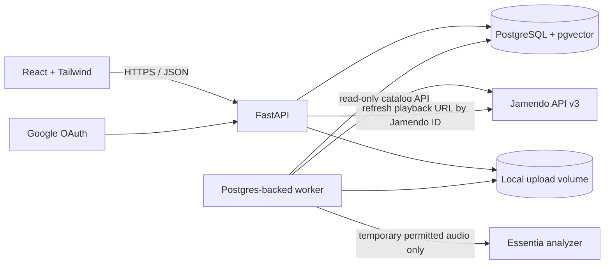

# VibeCast Architecture Audit and Design

## Architecture Assessment

VibeCast is a greenfield, full-stack application. The specification already fixes Python/FastAPI, React/Tailwind, PostgreSQL, SQLAlchemy/Alembic, sentence-transformers, pytest, and Jamendo as the only external music catalog. This design follows those choices and keeps catalog, listening history, recommendations, analytics, and access control in one coherent system.

The browser reads catalog data through VibeCast's API and PostgreSQL. Jamendo is the only external catalog; first-party uploads use an explicit, separate source and ownership model.

## Existing Repository Assessment

- The repository contains only `README.md` with a one-line project description.
- There is no backend, frontend, schema, migration, test suite, Docker configuration, CI workflow, or existing architecture to preserve.
- Git is on `main`, tracking `origin/main`, with a clean working tree at audit time.

## Required Components

1. `backend/`: FastAPI routes, Pydantic schemas, SQLAlchemy models, services, authentication, Jamendo adapter, recommendations, and worker commands.
2. `frontend/`: React, TypeScript, Vite, Tailwind, React Router, TanStack Query, and Recharts.
3. PostgreSQL with `pgvector`, Alembic migrations, database functions/triggers/views, and actual RLS policies.
4. One backend image with separate API and worker processes; a frontend image; PostgreSQL with persistent storage.
5. Local upload storage behind a provider interface; Essentia is an optional analysis extra and never makes catalog availability depend on analysis.
6. Pytest unit/API/PostgreSQL integration/RLS/security tests, frontend tests, and GitHub Actions checks.

## Database Design

- `users`: one role-bearing account table (`listener`, `artist`, `label_admin`, `platform_admin`) with unique email and optional unique Google subject.
- `labels`, `label_members`, and `artist_profiles`: first-party accounts and label membership. A VibeCast artist profile is separate from an external Jamendo artist.
- `catalog_artists` and `albums`: Jamendo entities keyed by unique external IDs; albums may be singles or absent.
- `songs`: `source` constrained to `jamendo` or `artist_upload`; unique nullable Jamendo track ID; separate Jamendo artist/album or VibeCast artist references; title, duration, tags, artwork, license, source URL, sync time, analysis status, and publication state.
- `song_features`: separately stored Essentia measurements and derived values, with analyzer/version metadata. Jamendo music information stays on the catalog song record; derived values are not labeled as Jamendo features.
- `song_embeddings`: model name/version and a normalized 384-dimensional pgvector vector, rebuilt from actual Jamendo metadata or validated first-party uploads.
- `playlists` and `playlist_songs`: owner, visibility, generation type, original prompt, generation time, ordering, and unique playlist/song pairs.
- `play_events`: user, song, start, duration, and qualification result. A play qualifies after 30 seconds or 80% of a short track; this same rule drives analytics and recommendations.
- `user_song_stats`, `user_daily_stats`, and `item_similarities`: atomic rollups and persisted collaborative-model output. Historical play events remain the source of truth.
- `jobs` and `catalog_sync_runs`: retryable job state, synchronization status/counts/timestamps, and safe error summaries.
- `auth_sessions`: session identifiers, expiry, and revocation for logout invalidation.

Constraints enforce valid roles/sources, non-negative durations, unique external IDs/emails, foreign keys, and unique playlist/song relations. Indexes cover catalog search, external IDs, event chronology, and user/song access paths.

## Jamendo Integration Design

`JamendoClient` handles HTTP, timeout, retry/backoff, API error codes, and response normalization. `CatalogSyncService` performs idempotent artist/album/song upserts and records sync status.

The official v3 tracks endpoint requires a developer `client_id`; track search supports text and tag/fuzzy-tag filters, and `limit` is capped at 200 with offset pagination. Track payloads include Jamendo IDs, duration, artwork, stream URL, license URL, and optional music information. Singles may lack album fields, so album relations are nullable. The API documents `audiodownload_allowed`; the file endpoint rejects tracks when downloading is disallowed. Error code 6 denotes a rate limit. The docs publish no numeric rate quota or audio URL lifetime guarantee, so the client backs off on rate limits and playback refreshes a stream URL by track ID instead of treating a stored URL as permanent. [Tracks API](https://developer.jamendo.com/v3.0/tracks), [track file API](https://developer.jamendo.com/v3.0/tracks/file), [response codes](https://developer.jamendo.com/v3.0/response-codes)

Synchronization is configurable (`max_tracks`, `page_size`, search/tag queries), repeatable, and deduplicated on Jamendo IDs. It stores only metadata needed by the application and refreshes it during sync. Audio bytes are never retained. Analysis is queued only when download permission and the applicable content license allow temporary processing; the temporary file is deleted after analysis. An unavailable stream/analyzer does not remove a song from the catalog.

Jamendo requires attribution to creators and Jamendo plus a direct track-page backlink. Its terms allow non-commercial API use, restrict caching to what is reasonably necessary, and require content to reflect changes promptly. The terms page is marked last modified in 2013; hosted or commercial use should be reviewed with Jamendo before deployment. The local academic demo is configured as non-commercial and online-only. [Jamendo API terms](https://devportal.jamendo.com/api_terms_of_use)

## Recommendation Architecture

1. Build song text from Jamendo title/artist/album/tags and available music information, plus separately labeled Essentia/derived descriptors.
2. Generate and persist normalized SentenceTransformer embeddings in pgvector. Store model name/version so rebuilds are explicit and auditable.
3. Content score is cosine similarity between a user's weighted listening profile and each candidate. New users use actual qualified-play popularity and catalog recency.
4. Collaborative filtering is offline item-item cosine similarity over qualified play events, with capped play-count confidence and recency decay. Persist the sparse top-neighbor model/version in PostgreSQL; do not train it on recommendation requests.
5. Normalize component scores to `[0,1]`. Use a configurable hybrid blend (default 0.55 content / 0.45 collaborative when both exist), content/popularity fallback for cold start, and deterministic artist diversity.
6. Simulated listeners/events are generated only against songs already synced from Jamendo. A fixed seed controls generation; no synthetic songs or external listening dataset is used.

## Vibe Generation Architecture

`POST /playlists/vibe` validates prompt length, embeds the prompt with the same SentenceTransformer model, ranks actual catalog embeddings by cosine similarity, adds available tag/feature agreement, and applies deterministic artist diversity. Initial configurable weights are semantic `0.65`, tag `0.20`, structured features `0.15`; missing feature evidence is omitted and remaining weights are renormalized. The service persists the prompt and ordered songs as a playlist. No LLM API or random selection is involved.

## Authentication/RLS Design

- Listener sign-in uses Google OAuth with state validation. Staff accounts use Argon2 password hashes. Missing Google credentials disable the route with a clear configuration response rather than a fake sign-in.
- A short-lived JWT is held in a secure, HttpOnly, SameSite cookie. Its session ID is checked against `auth_sessions`; logout revokes it. Production requires HTTPS.
- Migrations use an owner credential; API/worker connections use a separate non-owner role without `BYPASSRLS`.
- At the start of each request transaction, the API sets transaction-local `app.user_id`, `app.role`, and a trusted worker flag. RLS policies use these values for owner/public/label/artist access. Values clear at transaction end, including on pooled connections.
- RLS protects private playlists, plays, per-user aggregates, profiles/uploads, and label-scoped resources. Public catalog rows remain readable; admin access is explicit. Tests connect as the runtime role, not migration owner.

## Background Jobs

A dedicated worker claims rows from PostgreSQL `jobs` with `FOR UPDATE SKIP LOCKED`, bounded retries, and safe error summaries. This avoids Redis or a broker. Jobs cover Jamendo sync, permitted temporary Essentia analysis, embeddings, collaborative-model rebuilds, and weekly playlist generation. Weekly jobs are idempotent per user/week and use the cold-start path.

## Frontend Architecture

React + TypeScript + Vite + Tailwind + React Router + TanStack Query + Recharts. Screens follow the brief: landing/auth, catalog/search/home, vibe results, player, stats, artist, label, and platform admin. The player reports measured listening intervals and submits play durations; Jamendo tracks show creator/provider attribution and link to the Jamendo page.

## Testing Strategy

- Current backend unit tests cover Jamendo response normalization and request parameters, vibe scoring, score normalization, play thresholds, production credential validation, and API startup/route registration. The frontend tests cover cookie/CSRF request behavior; the production build runs TypeScript checks.
- A gated PostgreSQL integration test checks private-playlist RLS, prevents runtime-role escalation, and verifies concurrent trigger rollups. CI creates the runtime role, applies migrations against pgvector PostgreSQL, and runs this test. It could not run in the current workspace because no PostgreSQL or Docker executable is installed.
- Live Jamendo sync and full API flows for auth, uploads, recommendations, and dashboards still need an environment with a database and Jamendo credentials. CI does not require external Jamendo credentials.
- The utility scripts exercise synthetic listening and lost-update versus atomic-increment behavior against a migrated database. Production has no fake provider catalog or synthetic records unless the explicit development-only simulator is run.

## Docker/Deployment Strategy

Docker Compose runs PostgreSQL with pgvector and a persistent volume, API/migrations, worker, frontend, and a persistent local-upload volume. Health checks gate startup. Environment variables configure secrets and URLs; `.env.example` contains placeholders only, and production settings reject placeholder JWT/database credentials. The documented deployment path is local/private academic demonstration until Jamendo's distribution scope is confirmed.

## Potential Problems

- Jamendo has not supplied a project-specific client ID; catalog sync/playback require user configuration. The repository must not invent a catalog while credentials are absent.
- Stream fields exist, but URL stability and numeric quotas are undocumented. Refresh-by-ID and conservative retry/backoff isolate those uncertainties.
- Download permission is per track. Essentia skips tracks without permission and cleans up temporary files.
- Jamendo's terms page is old and contains non-commercial, caching, attribution, and private/personal-use language. Local academic use is the working scope; public/commercial deployment needs confirmation.
- Google OAuth, HTTPS, and production secrets need external configuration; local staff authentication and Docker remain testable.
- Essentia wheels/system dependencies vary by platform. It is an optional worker extra with explicit `unavailable` status; metadata/embeddings still power recommendations.
- Without an initial Jamendo sync there are no real songs to recommend. The UI/API must report an empty catalog and guide an admin to configure/sync instead of showing fake rows.

## Blocking Questions

None for implementing the specified local, non-commercial project. Before a hosted or commercial release, confirm intended Jamendo use with Jamendo because the published terms restrict use and caching. API/OAuth credentials are runtime configuration, not architecture blockers.

## Safe Defaults

- Follow the specified stack; do not add another catalog, broker, or external LLM.
- Keep Jamendo IDs as external keys, allow singles, refresh stream links on play, attribute every track, and never store audio bytes.
- Use a Jamendo page size up to 200, a configurable sync cap, bounded retries, and backoff for rate-limit responses.
- Use Google OAuth for listeners and password login for staff; no hard-coded credentials or fake OAuth path.
- Use qualified real play events for analytics/recommendation training; generate simulated behavior only after real Jamendo songs exist.
- Skip unavailable/impermissible Essentia work without hiding tracks or inventing audio features.
